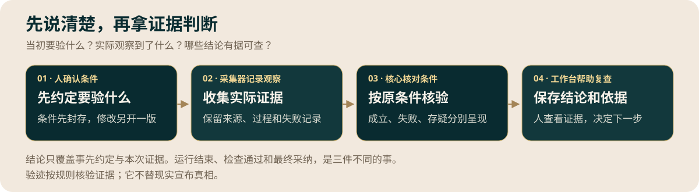
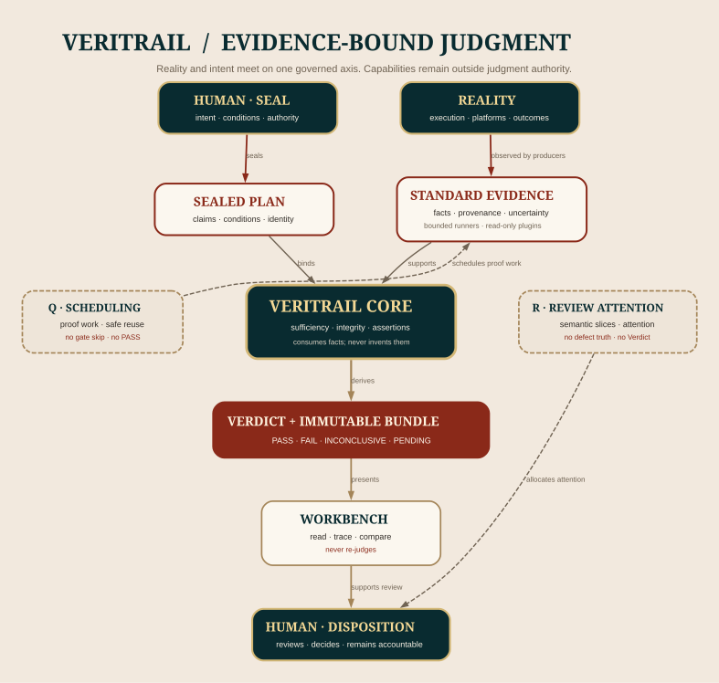

# VeriTrail / 验迹

> **做事留痕，立论有据，结论可验。**

AI说任务完成了。**但是，凭什么相信？**

验迹是一个本地运行的开源工程证据核验工作台。先约定要检查什么，再收集实际留下的证据，
最后按照事先约定的规则进行判断：哪些结论可以成立，哪些还缺少依据。

它已经能够在受支持的本地环境中进行工程验收、采集真实浏览器证据、保存和复查结果、比较多次运行，
并通过 GitHub 证据插件观察公开平台事实。

扩展方向包括运行状态与测试结果的证据采集、源码审查辅助，以及验证任务调度。运行与测试证据目前仍是候选方向；
源码审查的 private Fact projection / fulfillment 与 Fact → Coverage same-attempt handoff 合同及私有实现已经冻结；
ReviewSliceSet / Coverage composition qualification、vocabulary correction、Schema correction 与 root-binding correction
最小合同已经冻结；fresh CONTROL LOOP 当前只进入 CoverageLedger 0.3 child Schema / conformance 可行性审计；Schema 实现、
composition runtime、manifest successor 及完整 Review 产品均未开始；
验证调度仍处于蓝图阶段。

**工程验收 · 证据核验 · 本地优先 · 插件扩展 · 结果可复查**

[](https://github.com/NoctilumeDev/VeriTrail/actions/workflows/ci.yml) [](https://github.com/NoctilumeDev/VeriTrail/actions/workflows/browser-smoke.yml) [](https://github.com/NoctilumeDev/VeriTrail/actions/workflows/ci.yml) [](https://github.com/NoctilumeDev/VeriTrail/releases/tag/v0.13.0) [](https://github.com/NoctilumeDev/VeriTrail/releases/tag/github-evidence-v0.1.0) [](LICENSE)

## 看一个例子

让AI Agent开发一个网站。它写好了代码、跑过了测试，然后说：“可以交付了。”

可我们不知道的是：测的是约定的功能吗？真的操作过页面吗？失败记录有没有留下？证据够不够支持“完成”这个结论？

使用验迹时，可以先约定“首页能够打开，点击指定入口后显示预期页面”，再保存实际浏览器观察与运行记录，
按这些条件核验。通过、失败、存疑与缺证分别保留。

**它判断的是：这份证据是否满足事先确认的条件。** 条件是否完整、证据来源是否可靠，仍要结合具体项目复查。

## 十秒认识 VeriTrail

[](docs/assets/veritrail-at-a-glance.svg)

[打开大图](docs/assets/veritrail-at-a-glance.svg)

**接下来：** [亲手试一次](START_HERE.md) · [查看目前支持什么](#已交付能力与边界) · [了解扩展方向](#系统家族与未来边界) · [阅读技术文档](#阅读路径)

## 已交付能力与边界

<details>
<summary><strong>已有功能与使用入口</strong></summary>

## 选择入口

| 我现在要做什么 | 从这里进入 | 你会得到什么 |
| --- | --- | --- |
| 十分钟认识验迹 | [从这里开始](START_HERE.md) | 同一预注册标准下的一次真实 `PASS` 和一次故意 `FAIL` |
| 接入一个本地 Web 项目 | [Starter 0.2.0](https://github.com/NoctilumeDev/VeriTrail/releases/tag/starter-v0.2.0) | 有界 `single-webapp` / `static-site` 草案；保持 `DRAFT / NOT SEALED` |
| 用 AI 协助填写合同 | [Authoring Skill 0.2.0](https://github.com/NoctilumeDev/VeriTrail/releases/tag/authoring-skill-v0.2.0) | 有限 Preset 识别、缺失信息追问和候选草案；不封存、不裁决 |
| 直接使用稳定内核 | [Core 0.13.0](https://github.com/NoctilumeDev/VeriTrail/releases/tag/v0.13.0) | Plan、Evidence、四 Verdict、Acceptance Bundle、合成首跑与本地只读 Workbench |
| 采集公开 GitHub 事实 | [GitHub Evidence Plugin 0.1.0](https://github.com/NoctilumeDev/VeriTrail/releases/tag/github-evidence-v0.1.0) | 只读 API / Public Render Evidence 与 Core handoff |


Core 的 M0–M14 已形成单机可验证闭环，覆盖 sealed Plan、资源预检、真实 Chromium Evidence、只读
Workbench、不可变 Catalog、同计划比较、四角色配对、批次矩阵、可信有界命令、完整项目自举、真实
项目链路与最终发布。每项能力只对其冻结合同中的环境、拓扑与威胁边界成立。

### M0–M14 能力索引

| Milestone | Capability | Status |
| --- | --- | --- |
| M0 | 封存计划、证据导入与确定性裁决 | `FROZEN` |
| M1 | 启动前资源与环境预检 | `FROZEN` |
| M2 | 有界真实 Chromium 证据 | `FROZEN` |
| M3 | 只读 Vue 证据工作台 | `FROZEN` |
| M4 | 本地 Run Catalog 与轻量自举 | `FROZEN` |
| M5 | 有界运行编排与静态目标生命周期 | `FROZEN` |
| M6 | 同计划复跑确定性比较 | `FROZEN` |
| M7 | 预注册四角色配对反事实分析 | `FROZEN` |
| M8 | 全因子批次矩阵与固定种子扰动 | `FROZEN` |
| M9 | 受控项目命令执行 | `FROZEN` |
| M10 | 有界完整项目自举 | `FROZEN` |
| M11 | 真实项目功能全链路 | `FROZEN` |
| M12 | Palace Evidence Workbench | `FROZEN` |
| M13 | 系统与分层代码质量终审 | `FROZEN` |
| M14 | 整改后终局复验与发布收束 | `FROZEN / RELEASED` |

移动端历史连续性反例已在
[M12 Workbench 历史连续性维护合同](docs/232-m12-workbench-history-continuity-maintenance-contract.md)
中显式重开最小 `L0_PRESENTATION + BOUNDED_L1_COMPONENT` 边界。它当前只是独立维护候选；历史
`m12-v0.13.0`、Core、Evidence、Catalog 与 Verdict 冻结事实均未改变。

## 开始使用

第一次接触请优先走 [START_HERE](START_HERE.md) 的十分钟 PASS / 故意 FAIL 黄金路径。下面是源码
工作区的最小 Core 入口；浏览器采集和 Windows 受控进程能力保持可选安装。

```powershell
python -m venv .venv
.\.venv\Scripts\python.exe -m pip install --upgrade pip
.\.venv\Scripts\python.exe -m pip install --editable ".[browser,command-windows]"
.\.venv\Scripts\python.exe -m playwright install chromium
```

封存一个最小计划并计算 Run：

```powershell
.\.venv\Scripts\veritrail.exe seal `
  --plan examples\minimal\plan.json `
  --output artifacts\m0-sealed-plan.json

.\.venv\Scripts\veritrail.exe evaluate `
  --plan artifacts\m0-sealed-plan.json `
  --evidence examples\minimal\evidence-pass.json `
  --run-id my-first-run `
  --output artifacts\my-first-run
```

开发者需要复现 Public CI、Starter、Authoring Skill、Workbench 或发布资产时，请按
[贡献指南](CONTRIBUTING.md)和[里程碑索引](docs/milestones.md)中的对应合同运行完整矩阵；首页不复制整套
发布门禁命令。

</details>

## 系统家族与未来边界

<details>
<summary><strong>扩展构想与研究状态</strong></summary>

## 当前状态

已有产品、内部机制与候选问题分别列出；下面是成熟度摘要，不把路线图当成实现证据。
完整状态标识、资格链与保留失败见[首页工程记录保留页](docs/readme-engineering-records.md#精确状态与施工记录)及[里程碑索引](docs/milestones.md)。

### 已交付产品

- **Core / M**：计划、证据、运行、裁决与不可变 Bundle。当前为 `v0.13.0 RELEASED / MAINTENANCE_FROZEN`，M0–M14 已冻结。见[发布事实](docs/106-core-v0.13.0-release-readback-facts.md)。
- **Entry / E**：Starter 与 Authoring Skill `0.2.0 RELEASED`，只生成并校验草案。见[入口层发布说明](docs/70-entry-layer-e3-0.2-release-notes.md)。
- **Platform / P**：观察外部平台事实。GitHub Evidence `0.1.0` 已发布；其他平台仍为候选，插件不成为新的事实中心。见[插件合同](docs/78-github-evidence-plugin-contract.md)与[发布读回](docs/108-p4-github-evidence-release-readback-facts.md)。

### 研究与候选方向

- **Review / R — 源码审查辅助**：确定性源码事实、语义切片与未来注意力提案。部分 private 机制已冻结，完整产品未发布。
  Parse private A–H 与 Parse → Fact consumer private A–J 已冻结，完整 Review 产品仍未发布。
  [Fact 当前状态再审计](docs/251-r1-fact-projection-fulfillment-current-state-audit.md)已完成自己的资格链；
  [完整 Fact 全集与履责最小合同](docs/252-r1-fact-projection-universe-and-fulfillment-contract.md)已由
  [独立冻结发布](docs/253-r1-fact-projection-fulfillment-contract-freeze-publication.md)闭合为 frozen 事实；
  [私有实现可行性审计](docs/254-r1-fact-projection-fulfillment-private-implementation-feasibility-audit.md)已闭合为 qualified history。
  [私有实现授权发布](docs/255-r1-fact-projection-fulfillment-private-implementation-authorization-publication.md)的最后门已闭合，
  fresh CONTROL LOOP 与独立阶段确认后进入的[完整 Fact 私有实现候选](docs/256-r1-fact-projection-fulfillment-private-implementation-candidate.md)
  已由[独立冻结发布](docs/257-r1-fact-projection-fulfillment-private-implementation-freeze-publication.md)闭合为 frozen
  upstream。[Fact → Coverage handoff 当前状态审计](docs/258-r1-fact-to-coverage-same-attempt-handoff-current-state-audit.md)
  已闭合为 qualified history；[最小 handoff 合同](docs/259-r1-fact-to-coverage-same-attempt-handoff-contract.md)
  已由[独立冻结发布](docs/260-r1-fact-to-coverage-handoff-contract-freeze-publication.md)闭合为 frozen 事实；
  [私有实现可行性审计](docs/261-r1-fact-to-coverage-handoff-private-implementation-feasibility-audit.md)已完成自己的资格链；
  [私有实现授权发布](docs/262-r1-fact-to-coverage-handoff-private-implementation-authorization-publication.md)的最后门已闭合，
  fresh CONTROL LOOP 后进入的[私有实现候选](docs/263-r1-fact-to-coverage-handoff-private-implementation-candidate.md)
  已由[独立冻结发布](docs/264-r1-fact-to-coverage-handoff-private-implementation-freeze-publication.md)闭合为 frozen upstream；
  [ReviewSliceSet / Coverage composition 状态审计](docs/265-r1-review-slice-set-coverage-composition-current-state-audit.md)
  与[composition precontract audit](docs/266-r1-review-slice-set-coverage-composition-precontract-audit.md)均已完成自己的资格链；
  [composition qualification 最小合同](docs/267-r1-review-slice-set-coverage-composition-qualification-contract.md)
  已由[独立冻结发布](docs/268-r1-review-slice-set-coverage-qualification-contract-freeze-publication.md)闭合为 frozen 事实。
  [vocabulary correction 状态审计](docs/269-r1-review-slice-set-coverage-vocabulary-correction-current-state-audit.md)
  已成为 qualified history；[vocabulary correction 最小合同](docs/270-r1-review-slice-set-coverage-vocabulary-correction-contract.md)
  已由[独立冻结发布](docs/271-r1-review-slice-set-coverage-vocabulary-correction-contract-freeze-publication.md)闭合为 frozen
  事实。[Schema correction 可行性审计](docs/272-r1-review-slice-set-coverage-schema-correction-feasibility-audit.md)
  已成为 qualified history；[Schema correction 最小合同](docs/273-r1-review-slice-set-coverage-schema-correction-contract.md)
  已由[独立冻结发布](docs/274-r1-review-slice-set-coverage-schema-correction-contract-freeze-publication.md)闭合为 frozen 事实。
  #317 的旧审计候选没有取得资格；Browser fixture resource-isolation maintenance 完整闭合后，fresh CONTROL LOOP 从
  `main@5b0ba6d…` 重新生成的[root-binding 状态审计](docs/279-r1-review-slice-set-coverage-schema-root-binding-current-state-audit.md)
  已成为 qualified history。它证明 projection-blocked handoff保留 `fact_set = null`，而 frozen CoverageLedger root仍要求
  `fact_set_digest`。[root-binding correction 前合同审计](docs/280-r1-review-slice-set-coverage-root-binding-correction-precontract-audit.md)
  已成为 qualified history，进一步证明 Fact / Relation / ReviewSlice 三段 qualified absence 与 manifest negative-world topology
  是不同 seam。[root-binding correction 最小合同候选](docs/281-r1-review-slice-set-coverage-root-binding-correction-contract.md)
  已在 `main@e0de755…` 完成自己的资格链，并由
  [独立冻结发布](docs/282-r1-review-slice-set-coverage-root-binding-correction-contract-freeze-publication.md)闭合为 frozen
  事实。fresh CONTROL LOOP 当前进入
  [CoverageLedger 0.3 child Schema / conformance 可行性审计](docs/283-r1-review-coverage-ledger-0-3-schema-conformance-feasibility-audit.md)：
  只审有限 child shape、versioned conformance 与 private history inputs；不创建 Schema/runtime，不合并 manifest successor
  或 composition，不选择 persistence。
- **Quick / Q — 验证调度与 Evidence 安全复用**：`Q0_BLUEPRINT_FROZEN / Q_IMPLEMENTATION_NOT_STARTED / NO_GATE_SKIP_AUTHORITY`。
  缺失或卸载时退回完整串行验证，语义不变。见[Q0 冻结记录](docs/119-q0-verification-scheduling-final-freeze-closure.md)。
- **Operations Evidence / O — 运行与系统状态观察**：候选只读问题面；没有插件、Provider、Schema、动作权或运行时。
  见[O0 问题定位](docs/180-o0-operations-evidence-problem-framing.md)。
- **Test Evidence / T — 测试发现、执行与报告身份观察**：候选只读问题面；测试选择、执行、重试与 fixture authority 仍为 `UNKNOWN`。
  见[T0 问题定位](docs/181-t0-test-evidence-problem-framing.md)。

R/Q 是独立职责，不统称为证据插件。O/T 也没有因为进入这张表而取得实现权。

### 与独立系统的关系

VeriTrail 不是把所有能力都吸进 Core 的“超级平台”。跨系统关系应通过稳定合同、不可变 Artifact 和
可替换 adapter 建立：

| 独立系统 | 负责 | 关系边界 |
| --- | --- | --- |
| [JPyxis](https://github.com/NoctilumeDev/JPyxis) | 异构计算中的控制、定义与运行时分权 | 未来可通过 execution receipt / Evidence adapter 对接，不是当前集成声明 |
| [FlowKernel](https://github.com/NoctilumeDev/FlowKernel) | 不可靠策略与确定性权限、资源、隔离边界 | 独立 Planned 仓库；不是当前可运行依赖 |

这些关系是认知地图，不是当前集成声明。一个独立系统最多通过不可变 Artifact / Evidence adapter 接入
VeriTrail；事件可以跨界，状态所有权、执行入口、凭据与 Verdict 权不能跨界。

拆分也不由模块数量、业务名词或数据库数量机械决定。这里采用的原则是：**最小闭环内部允许与同一
不变量一致的强耦合；闭环之间必须通过稳定合同强解耦。**边界未知时先建立可验证的最小闭环，等待真实
反例暴露 state ownership、事务、失败恢复和独立生命周期压力。完整判据见
[能力边界与系统认知地图](docs/114-capability-boundary-and-system-map.md)。

</details>

## 深入阅读

<details>
<summary><strong>工作原理与安全边界</strong></summary>

VeriTrail（验迹）把事先封存的验收条件、来自真实执行或外部平台的证据，以及确定性裁决分开保存。
它帮助独立开发者和小型团队回答：**这次到底证明了什么，依据是什么，边界在哪里，失败应回到哪一层排查。**



<p align="center"><sub>中轴实线是证据与裁决链，两翼虚线是可替换的辅助能力；图中两端的 Human authority 属于同一权威域。</sub></p>

这不是一条把所有能力串成单体流水线的图。Core 只消费 sealed Plan 与标准 Evidence；R 面向人的审查
注意力，Q 面向证明义务的执行效率，两者都不能获得 Core Verdict 权。Workbench 负责展示和验真，
不在浏览器里重新裁决。

图中的 Evidence producer 是一个权威角色，不等于某个固定插件。当前已交付的是 GitHub Evidence P 轨；
[O0 Operations Evidence](docs/180-o0-operations-evidence-problem-framing.md) 与
[T0 Test Evidence](docs/181-t0-test-evidence-problem-framing.md) 只保存新的候选观察问题，没有运行时、
公共 Schema 或产品坐标。架构图因此只画通用只读 Evidence 边界，不把 O/T 预演成已实现模块。

| 责任 | 谁拥有 | 明确不拥有 |
| --- | --- | --- |
| 前提、目标与 Seal 决定 | Human authority | 世界终极真相 |
| 事实采集与来源说明 | Evidence producer / plugin | 验收标准与 Verdict |
| 证据充分性与确定性裁决 | VeriTrail Core | 外部事实、执行资源与人工处置 |
| 最终处置 | Human authority | 改写历史 Evidence 或伪造确定性 |

> **现实拥有真相，VeriTrail 只拥有裁决纪律。**

## 系统分层

各层通过版本化合同和不可变 Artifact 组合；依赖不等于 ownership，消费也不等于继承状态机。
这里说明职责，不重复记录各轨施工进度；成熟度见[当前状态](#当前状态)。

| 层 | 回答的问题 | 主要产物 | 权限边界 |
| --- | --- | --- | --- |
| Entry / Authoring | 怎样更容易起草一个可检查的计划？ | `DRAFT / NOT_SEALED` Plan | 不 Seal、不运行、不裁决 |
| Evidence | 真实执行或外部平台观察到了什么？ | 标准 Evidence + provenance | Producer 只报告事实，不能输出 Verdict-like 结论 |
| Core | 给定 Plan 与 Evidence，条件是否满足？ | `PASS / FAIL / INCONCLUSIVE / PENDING` + Bundle | 只使用版本化规则，不拥有世界真相 |
| Workbench | 人怎样读懂并复核这些 Artifact？ | 本地只读视图 | 不写回、不重新裁决 |
| Review Attention / R | 人应该优先看哪些源码关系与切片？ | Review Artifact / Attention Proposal | 不决定缺陷真值，不取得 Core Verdict 权 |
| Verification Scheduling / Q | 既定证明义务怎样减少无效重算？ | 候选 Schedule / Evidence reuse binding | 不改变证明义务与 Verification semantics，没有 Gate 跳过权 |


<p align="center"><sub>Workbench 是证据的只读阅读面；宫阙视觉语言不改变任何裁决语义。</sub></p>

## 它解决什么

工程项目很容易把局部绿灯误当成整体完成：单元测试通过，但真实浏览器存在失败请求；单实例正常，
多实例出现重复副作用；一次压测写着“并发 1000”，却没有说明总请求、同时在途、RPS 或热点竞争数。

VeriTrail 不替代测试框架、CI、浏览器或监控。它在这些工具之上建立一条可复算的验收链：

```text
sealed Plan / Profile
  -> resource and environment preflight
  -> bounded target lifecycle
  -> structured Evidence collection
  -> deterministic Core evaluation
  -> immutable Bundle and Catalog
  -> comparison / paired / batch analysis where applicable
  -> owned cleanup and residual verification
```

核心方法只有五条：冻结基线；一次只改变一个主要变量；用显式组合矩阵验证交互；用固定种子寻找并
复现偶发问题；最后用真实链路验证系统结论。资源限制可以停止升压，但不能降低一致性与安全不变量。

## 结论语言

运行是否结束和证据能否支持结论是两件事，因此必须分开保存：

| Dimension | Values | Meaning |
| --- | --- | --- |
| ExecutionStatus | `PLANNED / RUNNING / COMPLETED / ABORTED / ERROR` | 实验是否完整执行 |
| Verdict | `PASS / FAIL / INCONCLUSIVE / PENDING` | 当前证据能否支持判断 |

- `PASS`：适用证据齐全，硬性不变量成立；
- `FAIL`：至少一个硬性不变量被可复现证据否定；
- `INCONCLUSIVE`：变量污染、环境漂移或证据冲突导致无法归因；
- `PENDING`：尚未取得计划要求的真实证据；
- `ABORTED` 是运行状态。资源停止线触发时保存现场，不伪造 `PASS / FAIL`。

## 公开证据与安全边界

`Public CI` 和 `Browser Smoke` 提供平台对齐、双 Python、构建、真实 Chromium 与公开资产读回的快速
基线。它们不能替代物理键盘、完整真实项目、受控宿主机资源停止线或清理读回；GitHub 绿灯不自动等于
整个里程碑 `PASS`。

VeriTrail 的安全边界同样是有界的：

- 默认只接受显式回环目标，不读取浏览器 Profile，不持久化 Cookie、Authorization 或响应正文；
- Plan、Evidence、报告与附件通过规范化 JSON、清单和 SHA-256 建立可复核关系；
- M9/M10 只运行结构化、经预览摘要批准的可信本地命令，不接受 Shell 字符串；新版 Preview 还绑定
  精确受保护源码状态，并在启动前复核，边界见[获批源码状态连续性维护合同](docs/168-approved-source-state-continuity-maintenance-contract.md)；
- Windows Job Object、listener owner 与资源上限限制误杀和残留，但不构成恶意代码沙箱；
- AI 可以提出关注候选、解释异常或建议补证，不能确认缺陷真值，也不能决定 `PASS / FAIL`。

## 信任与认识论上限

VeriTrail 擅长发现封存坐标之后的漂移、错绑、漏证据与规则不一致；它不能仅凭一条内部自洽的证据链
证明最初事实真实，也不能裁定提出者的观点在终极意义上正确。

```text
Consistency != Authenticity != Truth
Verification Correctness != Specification Correctness
Not responsible for Truth != Not responsible for Uncertainty
```

现实若模糊、不完整、冲突或不可判，系统必须保留这种不确定性。精确边界见
[产品定义](docs/00-product-brief.md)与[GitHub Evidence Plugin 合同](docs/78-github-evidence-plugin-contract.md)。
简单说：**它防的是漂移，不是阴谋；它负责的是裁决秩序，不是真理本身。**

</details>

## 阅读路径

<details>
<summary><strong>工程历史与技术文档</strong></summary>

### 第一次来

1. [十分钟 PASS / 故意 FAIL](START_HERE.md)
2. [产品定义](docs/00-product-brief.md)
3. [证据与实验模型](docs/01-evidence-model.md)

### 想理解系统边界

1. [架构与安全边界](docs/02-architecture.md)
2. [验收标准](docs/03-acceptance.md)
3. [能力边界与系统认知地图](docs/114-capability-boundary-and-system-map.md)

### 想知道当前主线之外保留了哪些问题

- [Product Delivery D0：真实任务入口的问题定位](docs/166-d0-product-delivery-problem-framing.md)与
  [Cu0：工程记忆注意力投影的问题定位](docs/167-cu0-engineering-memory-attention-projection-problem-framing.md)
  是 2026-09-15 的候选认知记录，不授权施工；Review Attention R 仍是当前串行施工主线，继续遵守自身合同门禁。
- [O0 Operations Evidence：运行事实观察的问题定位](docs/180-o0-operations-evidence-problem-framing.md)与
  [T0 Test Evidence：测试事实观察的问题定位](docs/181-t0-test-evidence-problem-framing.md)是 2026-09-21
  从 Core 通用性复核中保留下来的候选方向。两者都不改 Core，也未冻结“两个插件”的最终部署形状。
- [Q0 Quick Verification Scheduling 冻结记录](docs/119-q0-verification-scheduling-final-freeze-closure.md)
  已经存在；新的优先顺序不改写 Q0，也不启动 Q 实现。

### 想看外部方法参照

- [Vera 方法参照：可吸收经验与边界记录](docs/related-work-vera-method-note.md)只保存一次
  related-work 对照：它区分可迁移的方法、不可照搬的裁决语义与尚未成立的组合假设，不修改 R1
  doc189 A–H，不授权 Q、O、T、Core、Schema、publisher、adapter 或 benchmark 施工。

### 想复核工程事实

- [里程碑冻结历史与完整文档索引](docs/milestones.md)：集中查询冻结边界、来源坐标和保留失败；
- [首页工程记录保留页](docs/readme-engineering-records.md)：保留从本次候选首页迁出的长篇记录，以及原来的 106 项工程事实入口；
- [M14 最终验证与发布事实](docs/56-m14-final-validation-and-release-facts.md)与[GitHub Evidence Plugin 发布读回](docs/108-p4-github-evidence-release-readback-facts.md)：复核已交付产品；
- [Parse → Fact consumer A–J 冻结发布](docs/250-r1-parse-to-fact-consumer-private-implementation-freeze-publication.md)与[Fact 当前状态再审计及条件化后继计划](docs/251-r1-fact-projection-fulfillment-current-state-audit.md)：区分已有 product-use proof 与尚未建立的完整 Fact 履责；
- [Fact projection universe / fulfillment 合同候选](docs/252-r1-fact-projection-universe-and-fulfillment-contract.md)：复核全集 owner、五类投影、逐 Provider 责任与 successor admission 的最小语义边界；
- [Fact projection universe / fulfillment 独立冻结发布](docs/253-r1-fact-projection-fulfillment-contract-freeze-publication.md)：保留已资格化合同字节，区分 frozen target、生效门与尚未授权的实现；
- [Fact 私有实现可行性审计历史](docs/254-r1-fact-projection-fulfillment-private-implementation-feasibility-audit.md)：区分真实 Parse products、有限五类模型、verifier falsifier 与尚未开始的 successor runtime；
- [Fact 私有实现条件授权](docs/255-r1-fact-projection-fulfillment-private-implementation-authorization-publication.md)：保存审计资格，限定有限私有施工面；自己的最后门未闭合前 ALLOWED 不生效；
- [Fact 私有实现候选](docs/256-r1-fact-projection-fulfillment-private-implementation-candidate.md)：保存 private A–J 的实现、反证、完整资格矩阵与候选读回；
- [Fact 私有实现独立冻结发布](docs/257-r1-fact-projection-fulfillment-private-implementation-freeze-publication.md)：以自己的最后门条件化发布 private implementation frozen 状态，不授权后继 Coverage；
- [Fact → Coverage same-attempt handoff 当前状态审计](docs/258-r1-fact-to-coverage-same-attempt-handoff-current-state-audit.md)：复核 frozen Fact history、现有 continuation surface、negative worlds 与后继 Coverage vocabulary seam；不创建 handoff 合同或 runtime；
- [Fact → Coverage same-attempt handoff 最小合同候选](docs/259-r1-fact-to-coverage-same-attempt-handoff-contract.md)：冻结 claim owner、完整 history、negative branches、U slot 与 one-shot authority；不启动 runtime 或 Coverage；
- [Fact → Coverage same-attempt handoff 合同独立冻结发布](docs/260-r1-fact-to-coverage-handoff-contract-freeze-publication.md)：保留 doc259 已资格化字节，条件化发布 frozen target；不授权 handoff 实现、persistence 或 Coverage；
- [Fact → Coverage handoff 私有实现可行性审计](docs/261-r1-fact-to-coverage-handoff-private-implementation-feasibility-audit.md)：复核完整 Fact history、safe-negative worlds、one-shot source 与现有 runtime primitives；不修改 runtime；
- [Fact → Coverage handoff 私有实现授权发布](docs/262-r1-fact-to-coverage-handoff-private-implementation-authorization-publication.md)：限定 bounded A–J 施工面；自己的最后门闭合以前 `ALLOWED` 不生效；
- [Fact → Coverage handoff 私有实现候选](docs/263-r1-fact-to-coverage-handoff-private-implementation-candidate.md)：保存 A–J 实现、FCHC falsifier、六世界矩阵、完整资格门与 retained failures；
- [Fact → Coverage handoff 私有实现独立冻结发布](docs/264-r1-fact-to-coverage-handoff-private-implementation-freeze-publication.md)：保留 doc263 已资格化字节，条件化发布 private implementation frozen 状态；不启动 Coverage；
- [ReviewSliceSet / Coverage composition 当前状态审计](docs/265-r1-review-slice-set-coverage-composition-current-state-audit.md)：复核 frozen Fact handoff、独立 Relation/Slice history、U-slot identity/disposition 与 seven-stage cross-stage join；不创建合同、runtime 或 Schema；
- [ReviewSliceSet / Coverage composition precontract audit](docs/266-r1-review-slice-set-coverage-composition-precontract-audit.md)：收敛 exact-input/live-authority join、denominator owner、admission 顺序与 version stop；不创建合同或 runtime；
- [ReviewSliceSet / Coverage composition qualification 最小合同候选](docs/267-r1-review-slice-set-coverage-composition-qualification-contract.md)：冻结 single-attempt composition、applicability、transition proof、ReviewSliceSet admission 与 Coverage qualification；不授权 Schema correction、runtime 或 publication；
- [ReviewSliceSet / Coverage composition qualification 合同独立冻结发布](docs/268-r1-review-slice-set-coverage-qualification-contract-freeze-publication.md)：保留 doc267 已资格化字节，条件化发布 frozen target；不授权 vocabulary correction、runtime 或 persistence；
- [ReviewSliceSet / Coverage vocabulary correction 当前状态审计](docs/269-r1-review-slice-set-coverage-vocabulary-correction-current-state-audit.md)：复核 0.1 reason/disposition 缺口与 immutable version stop；不修改 Schema 或 runtime；
- [ReviewSliceSet / Coverage vocabulary correction 最小合同候选](docs/270-r1-review-slice-set-coverage-vocabulary-correction-contract.md)：冻结 carrier-neutral terminal/family/reason 语义、0.1 immutability 与 successor stop；不选择 public Schema 或 runtime；
- [ReviewSliceSet / Coverage vocabulary correction 合同独立冻结发布](docs/271-r1-review-slice-set-coverage-vocabulary-correction-contract-freeze-publication.md)：保留 doc270 已资格化字节，条件化发布 frozen target；不授权 successor Schema、composition runtime 或 persistence；
- [ReviewSliceSet / Coverage Schema correction 可行性审计](docs/272-r1-review-slice-set-coverage-schema-correction-feasibility-audit.md)：复核有限 child successor、manifest/consumer dispatch、versioned conformance 与 0.1 immutability；不创建 Schema、runtime 或 persistence；
- [ReviewSliceSet / Coverage Schema correction 最小合同候选](docs/273-r1-review-slice-set-coverage-schema-correction-contract.md)：冻结 CoverageLedger 0.2 child identity、最小 blocker carrier、versioned conformance、dispatch 与 0.1 immutability；不授权 Schema 实现、composition runtime 或 persistence；
- [ReviewSliceSet / Coverage Schema correction 合同独立冻结发布](docs/274-r1-review-slice-set-coverage-schema-correction-contract-freeze-publication.md)：保留 doc273 已资格化字节并闭合 frozen 状态；不自动授权 Schema implementation；
- [M10 Browser fixture resource-isolation maintenance](docs/278-m10-browser-hard-failure-fixture-resource-isolation-maintenance.md)：隔离普通 Browser semantic worlds 与 production-style host-memory 门，保留 #317/#318 首败与未知根因；
- [ReviewSliceSet / Coverage Schema root binding 当前状态审计](docs/279-r1-review-slice-set-coverage-schema-root-binding-current-state-audit.md)：从维护后的 exact main 重新复核 projection-blocked FactSet absence 与 frozen ledger root 的必填 digest 接缝；不修改合同、Schema 或 runtime；
- [ReviewSliceSet / Coverage root binding correction 前合同审计](docs/280-r1-review-slice-set-coverage-root-binding-correction-precontract-audit.md)：把单字段缺口扩展为 Fact / Relation / ReviewSlice 三段 present/absence root chain 与独立 manifest topology seam；不选择 carrier 或版本；
- [ReviewSliceSet / Coverage root binding correction 最小合同候选](docs/281-r1-review-slice-set-coverage-root-binding-correction-contract.md)：冻结 CoverageLedger 0.3 ordered root chain、versioned terminal-history projection、present/qualified-absence/qualified-unknown 语义、conformance 与 version/manifest stop；不授权 Schema 或 runtime；
- [ReviewSliceSet / Coverage root binding correction 合同独立冻结发布](docs/282-r1-review-slice-set-coverage-root-binding-correction-contract-freeze-publication.md)：保留 doc281 已资格化字节，条件化发布 frozen target；不授权 Schema、composition runtime、manifest successor 或 persistence；
- [CoverageLedger 0.3 child Schema / conformance 可行性审计](docs/283-r1-review-coverage-ledger-0-3-schema-conformance-feasibility-audit.md)：复核有限 root fragment、current private history、versioned conformance 与 manifest 独立停止线；不创建 Schema、runtime 或 successor；
- [Parse authorization exact-main CI 夹具观察修正](docs/242-r1-parse-authorization-ci-fixture-observation-correction.md)：保留独立失败观察与维护入口，不用后继成功覆盖历史。

## 发布坐标

- 当前 Latest Core：[`v0.13.0`](https://github.com/NoctilumeDev/VeriTrail/releases/tag/v0.13.0)，详见
  [0.13.0 Release Notes](docs/103-v0.13.0-release-notes.md)与
  [发布与公开读回事实](docs/106-core-v0.13.0-release-readback-facts.md)；
- 历史维护坐标：`v0.12.0 / v0.12.1 / v0.12.2` 均不可移动；
- GitHub Evidence Plugin：[`github-evidence-v0.1.0`](https://github.com/NoctilumeDev/VeriTrail/releases/tag/github-evidence-v0.1.0)，
  为 non-Latest 独立 Release；
- Starter 与 Authoring Skill：独立 `0.2.0` 坐标，并继续保持其 Core 0.12.x 兼容边界；
- [Core 0.12.2 发布与公开读回事实](docs/76-core-v0.12.2-release-readback-facts.md)继续保存旧维护线的精确证据。

已发布标签、资产和历史失败不得移动、重制或用后续绿灯覆盖。完整坐标与摘要见
[里程碑与文档索引](docs/milestones.md)。

</details>

## 项目来源与协作

VeriTrail 的方法来自受限单机上的真实工程实践：单变量验证因果、组合 Profile 覆盖交互、固定种子复现
偶发故障，并在资源停止线内守住一致性。PlainJournal 的 M0–M8 冻结基线是重要参考案例，但 VeriTrail
不把任何电商服务、中间件或业务状态机硬编码为产品前提。

- 提交可复现缺陷、边界明确的能力提案或 Pull Request 前，请阅读[贡献指南](CONTRIBUTING.md)；
- 重要 milestone 或 release 退出前，按[仓库遗留物收口门禁](docs/hygiene.md)清理无 owner 的可重建残留；
- 参与公开讨论与评审时，请遵守[社区行为准则](CODE_OF_CONDUCT.md)；
- 安全问题不要公开披露，请按[安全策略](SECURITY.md)使用私下报告路径。

## License

[Apache License 2.0](LICENSE)
